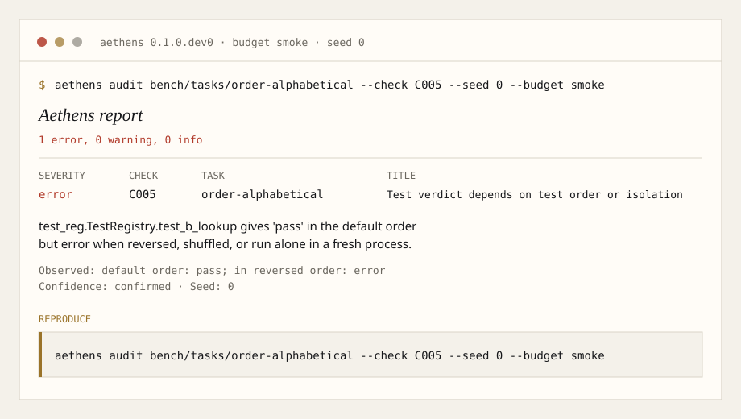
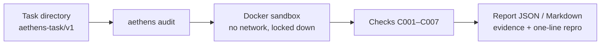

<div align="center">

<picture>
  <source media="(prefers-color-scheme: dark)" srcset="docs/assets/wordmark-dark.svg">
  
</picture>

# Aethens

**Audit the tests that score your agents.**

[](https://github.com/beastrog/aethens/actions/workflows/ci.yml)
[](LICENSE)
[](pyproject.toml)

An open-source Python CLI and GitHub Action that audits the verifiers of RL environments and code-task benchmarks by running them in a Docker sandbox. Every finding comes with evidence and a one-line repro command. The checks themselves have published precision and recall you can reproduce.

<br>

<picture>
  <source media="(prefers-color-scheme: dark)" srcset="docs/assets/report-c005-dark.svg">
  
</picture>

<p>
<sub>
Real report from <code>aethens audit bench/tasks/order-alphabetical --check C005 --seed 0 --budget smoke</code> (local run, 27 Nov 2026, aethens 0.1.0.dev0). Not a mock-up.
</sub>
</p>

</div>

Status: pre-release (`0.1.0.dev0`), Python tasks only. Licence: Apache-2.0. No LLMs, no network access for task code, no telemetry, no hosted service yet.

Use it before you train or evaluate on a set of coding tasks, to find tests that accept wrong solutions, reject right ones, or give different answers on different runs.

## Quickstart

Needs Docker and Python 3.11+. Aethens is not on PyPI yet. From a clone of this repository:

```sh
python -m pip install .
docker pull python:3.12-slim
aethens audit examples/add-two --format markdown
```

The example task is clean, so this prints a report with no error or warning findings (C004 may list info-level surviving mutants) and exits 0. Try a planted defect:

```sh
aethens audit bench/tasks/brokengold-offbyone --check C001 --format markdown
```

This exits 1 and reports "Gold solution fails the verifier", with the verifier's output and a repro command you can paste.

Useful options: `--budget smoke|standard|deep`, `--fail-on error|warning`, `--format json|markdown`, `--seed N`, `--check C00X` (repeatable), `--output FILE`. Exit codes: 0 pass, 1 findings at or above `--fail-on`, 2 tool error, 3 the gold solution timed out.

`--unsafe-local` runs task code directly on your machine without container isolation, with a scrubbed environment and timeouts. Only use it on code you trust.

GitHub Action (pin a release tag once one exists; `@main` is pre-release):

```yaml
- uses: beastrog/aethens@main
  with:
    path: path/to/tasks
    budget: standard
    fail-on: error
    seed: "0"
```

Tasks use the `aethens-task/v1` directory format: [docs/task-format.md](docs/task-format.md). Reports follow `aethens-report/v2`: [docs/report-schema.json](docs/report-schema.json).

## How it fits together



The CLI loads a task, runs its verifier inside a locked-down Docker container, and writes a report. It does not decide whether a solution is correct, and it is not a sandbox product: see [SECURITY.md](SECURITY.md).

<details>
<summary>What it is not</summary>

- It does not decide whether a solution is correct. Checks that judge candidates (C003) rely on the labels you provide, and every such finding says so.
- It does not prove a verifier is sound. No findings means only that these checks found nothing at the chosen budget and seed.
- It is not a sandbox product. It runs untrusted task code in Docker with a locked-down configuration (see [SECURITY.md](SECURITY.md)); that reduces risk but is not a guarantee.
- No LLMs, no network access for task code, no telemetry, no hosted service yet.

</details>

## Checks

Seven checks, each with a stated limit. Expand a row in [the full table](#check-reference) or read the summaries below.

| | Check | What it asks |
|---|---|---|
| Accept correct solutions | **C001** gold sanity, **C006** over-specified tests | Does the gold pass, and would a behaviour-preserving rewrite still pass? |
| Reject wrong solutions | **C003** labelled candidates, **C004** mutation probes, **C007** reward-hacking probes | Do labelled-wrong or mutated or gaming candidates get rejected? |
| Same result every run | **C002** adaptive flakiness, **C005** test order and isolation | Does the verdict hold across reruns, shuffles, and tests run alone? |

<details id="check-reference">
<summary>Check reference: what each can and cannot catch</summary>

| check | what it does | can catch | cannot catch |
|---|---|---|---|
| C001 gold sanity | runs the starting state (must fail) and the gold solution (must pass), once each | tests with no real assertions; a broken gold solution or wrong file layout | defects that only show on some runs (see C002) |
| C002 flakiness | runs the gold solution at least 3/5/10 times (smoke/standard/deep), varying only `PYTHONHASHSEED`; while every run agrees it keeps going (up to 6/11/59 runs, or 120/300/1800 s of run time) until it can state "flake rate below 0.5/0.25/0.05 at 95% confidence" (exact binomial bound, recorded in the report's coverage list) | verdicts that depend on set or dict ordering or `hash()`; flips rarer than the old fixed run count could see | flakiness from time, unseeded randomness or scheduling, except by chance; a flake rate below the stated bound |
| C003 labeled candidates | runs each candidate in `candidates/valid` and `candidates/invalid` | false rejects (over-strict tests) and false accepts (weak tests), but only as good as the labels; `llm-unreviewed` labels give warnings marked needs-review | anything for which you have no labeled candidate |
| C004 mutation probes | runs up to 5/10/30 AST mutants of the gold solution; each surviving mutant is then called side by side with the gold on the inputs the tests use plus derived inputs, inside the sandbox: a survivor that behaves differently is reported with that input as a counterexample, one that behaved like the gold on every valid input tried is not reported (listed in the report's coverage instead) | behaviour the tests never check (surviving mutants, info only) | a mutant that differs only on inputs the probe never tried is hidden (see the external bench for how often); a counterexample input may be outside the task's intended inputs; a killed mutant does not prove the tests are strong |
| C005 test order and isolation | reruns the gold's tests in their default order, reversed, in 1/2/5 seeded shuffles and each test alone (up to 10/30/200), all with the same `PYTHONHASHSEED`; a change must reproduce on a second run | tests that pass only because an earlier test left state behind, or that break when another test runs first | orders it did not try; verifiers other than `python -m unittest` (it says it checked nothing) |
| C006 over-specified tests | reruns the gold after behaviour-preserving AST rewrites (reformat, local renames, swapping adjacent constant assignments, append loop to comprehension, if/else inversion; smoke: the first two), each applied only where its safety conditions hold; a rejection must reproduce and the gold must still pass | tests that read the gold's source, line numbers, local variable names or code shape, so they would reject correct solutions written differently (warning, needs review) | over-strict tests on behaviour the statement leaves open, such as exact messages or float digits (use C003); rewrites it cannot prove safe are skipped |
| C007 reward-hacking probes | when the unsolved starter fails, runs candidates that do not solve the task, in the same sandbox: `os._exit(0)` on import, an atexit hook forcing exit 0, a unittest patch that reports success, a `sitecustomize.py` hook, functions returning an object equal to everything, and a lookup table of the visible tests' literal answers; an accepted probe must pass twice | verifiers a policy can game without solving the task (error; the lookup-table probe is a warning, needs review, since it matters only when tests are visible) | other gaming routes; pytest `conftest.py` hooks (not probed); a verifier that resists these probes can still be gamed |

</details>

## Published accuracy

The bench is **self-authored**: small original tasks written for this project, with defects planted on purpose (task list and expected findings: [bench/manifest.yaml](bench/manifest.yaml)). Its numbers show whether Aethens catches the defects that were planted. They do not measure real-world recall on other people's benchmarks.

The tables below are generated from the JSON in this repository, never typed by hand. Internal-bench figures match the `bench-results` artifact of [GitHub Actions run 45969249199](https://github.com/beastrog/aethens/actions/runs/45969249199) (push to `main` of `4d75c86`, 27 Nov 2026; aethens 0.1.0.dev0, seed 0, budget standard).

<!-- bench:start -->
Generated from `bench/results.json` (aethens 0.1.0.dev0, seed 0, budget standard) by `bench/render_readme.py`.

Bench: 34 self-authored tasks, 15 clean controls and 19 with planted defects.

| metric | value |
|---|---|
| precision (error/warning findings) | 1.0 |
| recall (planted defects found) | 1.0 (20/20) |
| false positives on controls | 0 |
| unexpected error/warning findings on defective tasks | 3 |
| info findings on controls | 6 |

| defect class | found / planted |
|---|---|
| weak-tests | 3/3 |
| over-strict | 5/5 |
| flaky | 3/3 |
| no-assertions | 2/2 |
| broken-gold | 2/2 |
| order-dependence | 5/5 |

| check | found / planted | false positives |
|---|---|---|
| C001 | 4/4 | 0 |
| C002 | 4/4 | 0 |
| C003 | 4/4 | 0 |
| C004 | 1/1 | 0 |
| C005 | 4/4 | 0 |
| C006 | 3/3 | 0 |

Known misses in this run:

- none

Reward hacking (C007), scored separately: each task lists the probe categories that should get through its verifier (labels in bench/manifest.yaml).

Overall: recall 1.0 (116/116), precision 1.0, false positives 0.

| exploit category | found / labelled | false positives |
|---|---|---|
| exit-zero | 30/30 | 0 |
| atexit-override | 30/30 | 0 |
| framework-patch | 30/30 | 0 |
| sitecustomize-hook | 1/1 | 0 |
| always-equal | 15/15 | 0 |
| hardcoded-visible | 10/10 | 0 |
<!-- bench:end -->

## Accuracy on public data Aethens did not write

The bench above is self-authored, so it can only show that Aethens finds what its authors planted. The external bench runs Aethens on public tasks and judges the results with an outside oracle. Method, ground truth and caveats: [bench/external/README.md](bench/external/README.md). Full write-up: [docs/EXTERNAL_BENCH.md](docs/EXTERNAL_BENCH.md).

The 164-task figures are taken from `bench/external/results.json` as committed in `4d75c86` on 27 Nov 2026. The full run is not regenerated by GitHub CI (`make check` runs a six-task sample only). [Hosted CI run 45969249199](https://github.com/beastrog/aethens/actions/runs/45969249199) is the main-branch check of that commit.

<!-- external:start -->
Generated from `bench/external/results.json` by `bench/external/render_external.py` (aethens 0.1.0.dev0, seed 0, budget standard).

On 164 HumanEval tasks (MIT), judged by EvalPlus's HumanEval+ tests (Apache-2.0) as an outside oracle:

- C004 precision 0.8158: 31 of 38 mutants that HumanEval's own tests accepted are rejected by HumanEval+.
- C004 recall 0.8 relative to exhaustive mutation (24 of 30 weak tasks found at budget standard).
- Without C004's equivalent-mutant filter (same run): precision 0.4615, recall 0.8667; the filter hid 51 survivors, 5 of which HumanEval+ rejects.
- Error/warning findings on checks without labels in this data (presumed clean): C001 0, C002 0, C005 0, C006 0. Details: [docs/EXTERNAL_BENCH.md](docs/EXTERNAL_BENCH.md).
<!-- external:end -->

## Compared with other auditor tools

Capabilities below are taken from [docs/COMPETITIVE.md](docs/COMPETITIVE.md), researched from public GitHub READMEs, arXiv, and project blogs on 18 Nov 2026. Where a claim comes from a project's own README or paper, it is that project's claim and has not been reproduced here. Star counts are omitted because they go stale.

| Capability | Aethens | [rlgate](https://github.com/deepak-foundryai/rlgate) | [BenchJack](https://github.com/benchjack/benchjack) | [Assay](https://github.com/caiotheodoro/assay) |
|---|---|---|---|---|
| What it is | Python CLI and GitHub Action that runs a task's tests in Docker | Python CLI (Harbor, SWE-bench, MiMo, YAML), GitHub Action, on PyPI as 1.0.0 | Hackability scanner: static tools plus Claude Code or Codex agents ([paper](https://arxiv.org/abs/2605.12673)) | Probe battery plus an LLM "auditor" that emits an Environment Card |
| Findings proven by execution | Yes | Yes | PoCs, in part | Yes (probes) |
| Test order and isolation | C005 | Not seen | Not seen | Not seen |
| Over-strict tests, no LLM | C006 rewrites; C003 if you supply labels | Only with the optional LLM layer | Not seen | Not seen |
| Reward-hacking probes | C007 (six families) | Yes | Yes | Yes |
| Solution / answer leakage | Not built | Yes | Yes | Not seen |
| Published accuracy of the auditor | Own planted-defect bench, and HumanEval judged by HumanEval+ | README: "Not yet built: dedup and calibration." | Not seen | Deterministic precision 0.757 on its own 33-environment, 54-defect corpus (project's claim). No public-data calibration seen. |
| LLM required? | No | Optional `--deep-review` | Agents used for exploitation | LLM auditor arm; probes can run without it |
| Licence | Apache-2.0 | MIT | Apache-2.0 | Apache-2.0 |

Aethens does not claim to have more probe families than these tools. Several already ship reward-hacking probes. The difference we put a number on is published, reproducible accuracy — including C004 precision on public data, with and without the equivalent-mutant filter.

Where Aethens is behind, as of that survey: own task format only; not on PyPI; no leak scanner; no Harbor or SWE-bench adapter yet.

<details>
<summary>Known misses and limits</summary>

- C005 reorders tests only for `python -m unittest` verifiers, and only tries the default order, reversed, a few seeded shuffles and each test alone; other orders are not tried.
- C006 only catches tests coupled to implementation details (source text, line numbers, local names, code shape). Its five rewrites are argued and tested to preserve behaviour, not machine-proved, and it skips every site it cannot show is safe. Its findings need review: a statement may legitimately require an implementation detail.
- C002 is still statistical: without a finding it states only that the flake rate is below a bound (0.25 at 95% confidence at the default budget, 0.05 at deep), assuming independent runs. A rarer flake can pass unseen, and the time budget can stop it before the target bound.
- C007 tries six probe families; resisting them does not prove a verifier cannot be gamed. It does not probe pytest `conftest.py` hooks. Almost every plain `python -m unittest` verifier is gameable by its exit-code probes, so expect C007 errors on most tasks until the harness judges results outside the solution's process (see bench/tasks/ctrl-hardened-harness for one way).
- Python tasks only; verifiers must be runnable as a command inside a Docker image with no network.
- Tested on Linux with Docker Engine. Rootless Docker, Docker Desktop and Podman are untested.

</details>

## Contributing, security and disclosure

See [CONTRIBUTING.md](CONTRIBUTING.md), [SECURITY.md](SECURITY.md), [CODE_OF_CONDUCT.md](CODE_OF_CONDUCT.md), the documentation index in [docs/README.md](docs/README.md), and the disclosure policy for findings about other people's benchmarks in [docs/DISCLOSURE.md](docs/DISCLOSURE.md).

The marketing site is at [beastrog.github.io/aethens](https://beastrog.github.io/aethens/). Questions and audit enquiries: [GitHub Discussions](https://github.com/beastrog/aethens/discussions). Founder: [Ani Dey](https://linkedin.com/in/aniruddha-dey-887b26312/).
